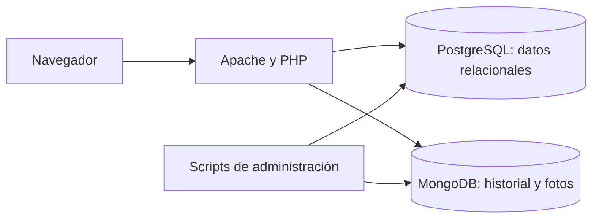

# Arquitectura del sistema

## 1. Visión general

Aplicación PHP organizada por responsabilidades, desplegada en tres servicios Docker. Apache publica únicamente `app/public`. Las vistas se generan en el servidor; las bases no se consultan directamente desde el navegador.



## 2. Estructura

```text
app/
  public/       index.php, acciones.php, salud.php, foto.php, CSS, JS y Bootstrap
  src/          conexiones, validaciones, operaciones y ayudantes de vistas
  vistas/       pantallas PHP/HTML
  verificar_consistencia.php
  Dockerfile
  php.ini
database/
  postgresql/   modelo, datos, funciones/procedimientos/triggers y permisos
  mongodb/      usuario, colecciones, validador, índices y datos iniciales
scripts/        instalación, administración y pruebas
tests/          recorrido de integración
docs/           arquitectura y bases de datos
compose.yaml
.env.example
README.md
```

`index.php` selecciona páginas de una lista cerrada; `acciones.php` recibe formularios; `src/operaciones.php` organiza las escrituras; `src/db.php` y `mongo.php` acceden a los motores. Las vistas también contienen consultas de lectura para mantener visible el ejemplo académico. No se implementa un MVC completo, un ORM ni una capa de servicios externa.

## 3. Endpoints y API

No existe una API REST de negocio. Los puntos de entrada son:

| Entrada | Método | Comportamiento |
|---|---|---|
| `/index.php?pagina=...` | GET | Presenta Resumen, Clientes, Equipos, Tickets, Técnicos, Catálogos o Auditoría |
| `/index.php?pagina=ticket&id=...` | GET | Muestra una atención y sus relaciones |
| `/acciones.php` | POST | Valida el formulario, ejecuta una acción y redirige con código 303 |
| `/salud.php` | GET | Devuelve JSON con el estado de conexión; 503 si falla un motor |
| `/foto.php?ticket=...&id=...` | GET | Comprueba la relación foto/ticket y devuelve la imagen |

La actividad académica se realiza con las instrucciones de [BASES_DE_DATOS.md](BASES_DE_DATOS.md), sin pantalla de laboratorio.

## 4. Modelo de datos

PostgreSQL tiene once tablas en cuatro esquemas. El recorrido principal relaciona cliente, equipo y ticket; una atención conserva asignaciones, diagnósticos y servicios; cada servicio tiene sus repuestos. Un trigger registra cambios de estado en auditoría.

MongoDB utiliza `historial_ticket`, con un documento por ticket, y `evidencias`, con un documento binario por foto. Las referencias entre motores son lógicas: `id_ticket`/`ticket_id` e `id_diagnostico`. No existen claves foráneas entre motores. El modelo detallado está en [BASES_DE_DATOS.md](BASES_DE_DATOS.md).

## 5. Flujos clave

**Cliente y equipo:** formulario → validaciones → `registrar_cliente()` → transacción PDO → inserción del cliente y su equipo → COMMIT. Una serie duplicada provoca ROLLBACK de ambos registros.

**Creación de ticket:** se inserta el ticket dentro de una transacción SQL, se crea su historial MongoDB y se confirma SQL. Si falla el COMMIT después de confirmar MongoDB, puede quedar un historial sin ticket. El verificador informa esta diferencia; no la repara.

**Asignación y cierre:** el formulario llama a un procedimiento SQL. La asignación conserva responsables anteriores, deja una asignación activa y recalcula disponibilidad. El cierre exige RESUELTO, completa fecha, finaliza asignaciones y produce auditoría. Los procedimientos bloquean técnicos en un orden fijo para serializar el recálculo de disponibilidad.

**Diagnóstico y fotos:** se validan primero todos los archivos; SQL registra el diagnóstico; MongoDB guarda las fotos y la actividad; finalmente se confirma SQL. No hay atomicidad entre motores: una interrupción puede dejar referencias pendientes de revisión.

## 6. Autenticación y autorización

- No existe inicio de sesión, registro de usuarios web ni permisos web por persona. El nombre escrito como responsable es texto del formulario, no una identidad autenticada.
- PHP se autentica ante PostgreSQL como `soporte_web`, sin superusuario, DELETE ni inserción directa de auditoría.
- La auditoría usa una función SECURITY DEFINER con `search_path` fijo. `session_user` registra la cuenta de conexión, no la persona que usó el navegador.
- MongoDB utiliza una cuenta `readWrite` restringida a su base; las cuentas administradoras se reservan para inicialización y scripts.
- Los formularios usan sesión y token CSRF. Las entradas se validan, las consultas SQL parametrizan valores y las salidas HTML se escapan.

El alcance es la red local del aula; no es un sistema listo para exposición pública.

## 7. Frontend

Vistas PHP y Bootstrap 5.3.9, servido desde archivos locales con licencia MIT. `styles.css` personaliza la presentación; `interfaz.js` filtra las filas ya cargadas en la lista de tickets. No hay SPA, compilación con Node.js ni solicitudes a un CDN al abrir la aplicación. La búsqueda local no consulta de nuevo al servidor.

## 8. Decisiones de diseño

| Decisión | Motivo y límite |
|---|---|
| PHP sencillo y acceso explícito a datos | Facilita estudiar cada operación; no pretende una arquitectura empresarial |
| Integridad relacional en PostgreSQL | FK, restricciones, funciones, procedimientos y triggers se pueden comprobar en el motor |
| Historial y fotos en MongoDB | Permite estudiar documentos, arrays y BSON; las actividades crecen dentro de un documento |
| Una foto por documento, máximo 5 MB | Mantiene cada archivo bajo el límite de documento; no se utiliza GridFS |
| Sin transacción distribuida | Reduce complejidad, pero exige reconocer y verificar inconsistencias entre motores |
| Volúmenes y cuentas separadas | Persistencia independiente de la imagen y aplicación sin credenciales administradoras |
| Inicialización solo con volúmenes nuevos | Ejemplo sencillo; no implementa migraciones de bases existentes |
| Una imagen PHP compartida | Las pruebas separan bases/red, sin multiplicar imágenes de aplicación |

Se recomienda una atención activa por equipo, pero no hay una restricción que lo imponga. La aplicación no implementa un proceso de purga, paginación del historial ni reparación automática.

## 9. Tests y verificaciones

`tests/recorrido.php` contiene comprobaciones de validación, permisos, transacciones, asignación, costos, fotos, documentos y formularios HTTP. Los scripts usan un proyecto aislado `soporte_php_pruebas`, puertos locales 18081/15434/37019 y volúmenes propios; retiran sus contenedores y red al terminar, conservando los volúmenes.

```powershell
# Windows; ejecutar cuando el cambio lo justifique.
powershell -ExecutionPolicy Bypass -File scripts/test.ps1
```

```sh
# Linux/macOS.
sh scripts/test.sh
# Verificación de solo lectura en la instalación normal.
docker compose exec -T web php verificar_consistencia.php
```

Para cambios visuales pequeños basta una revisión dirigida de las páginas afectadas; no es necesario ejecutar toda la suite. Las comprobaciones HTTP no sustituyen una revisión visual. Las ejecuciones anteriores al retiro del Laboratorio no describen exactamente la suite actual. No se afirma compatibilidad probada en otra computadora física o en macOS/Linux.
